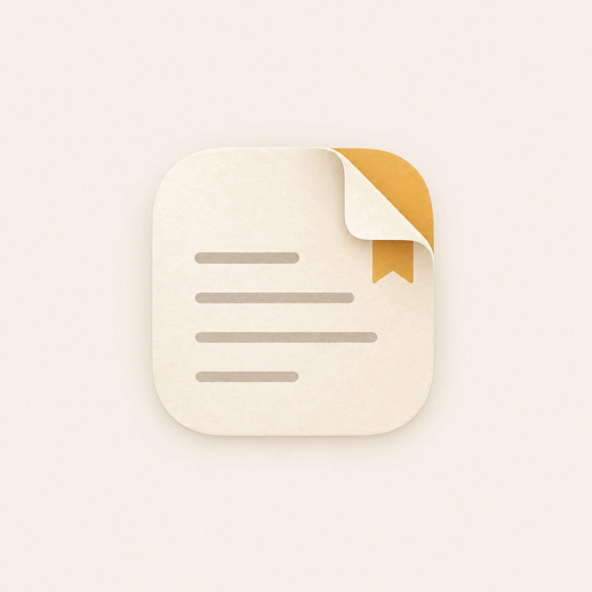
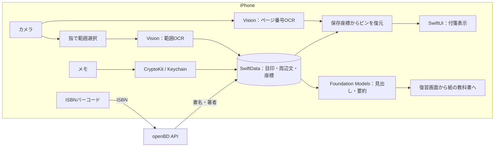

# FusenLess



**本はきれいなまま、学んだことは自分に残る。**

借りた本や売りたい教科書を汚さずに、付箋とメモを残せるiPhoneアプリです。ページを撮って気になる部分を指で囲み、内容を確認すると付箋を追加できます。見返して思い出せなければ、ページ番号を手掛かりに紙の教科書へ戻ります。

**[デモ動画を見る（YouTube）](https://youtube.com/shorts/XNKYjWmO3zk)**

[体験の流れ](#体験の流れ) · [開発の背景](#背景製品開発のきっかけ課題等) · [技術構成](#開発技術) · [起動方法](#起動方法) · [現在の制約](#現在の制約)

## 製品概要

### 体験の流れ

1. **教材を選ぶ**：ISBNバーコードから書名・著者を補完して登録。取得できなければ手入力します。
2. **撮って、囲む**：ページを撮影し、必要なら拡大して範囲を選択。ページ番号は自動入力され、誤認識時は修正できます。
3. **確認して、付箋にする**：選択部分のOCR結果を確認して追加。メモ・色・重要度を設定します。
4. **完了して、見返す**：「完了して付箋を確認」で付箋一覧シートを開きます。小口ビューのタブで該当ページへ移動し、付箋のタップで編集できます。
5. **撮り直して、続ける**：同じ教材・ページと判定できれば、保存した座標からピンを表示。本文OCRを待たずに続きを作れます。
6. **思い出して、紙へ戻る**：付箋の見出しと目印で振り返り、分からなければ紙の教科書を再確認。本が手元になければ「あとで教科書で確認」に残します。
7. **覚えたら、剥がす**：一覧の付箋を長押しして左右に動かすとゴミ箱へ。完全削除されるまでは復元できます。

> 撮影したページ画像は保存しません。残すのは、本・ページ番号・目印の文字列・周辺の数行・メモ・見出しや要約・色や復習状態・ピンの座標などです。通常のメモ保存ではCryptoKitによる暗号化を行います。

### 背景（製品開発のきっかけ、課題等）

情報系の分厚い専門書を図書館で借りて読むとき、大事な箇所に線を引いたり、自分の考えを書き込んだりできません。自分で買った教科書も、きれいに残して売りたいので書き込みたくない。

別のノートやNotionにメモすると、**どの本のどの箇所の話だったのか**が離れてしまいます。物理の付箋も、返却前に剥がして内容を書き写す必要があります。

チームの事前調査（Webアンケート11名＋対面の聞き取り5名、計16名。学生・大学院生ほか）では、次の声が集まりました。

| 質問・課題 | 回答 |
| --- | --- |
| 付箋を「何のために付けたか」思い出せないことがある | 13 / 16人（よくある5人、たまに8人） |
| FusenLessを「使いたい」「ぜひ使いたい」 | 13 / 16人 |
| 見返すとき、本をパラパラめくって探す | 11 / 16人 |
| 付箋が剥がれる、本が膨らむ、本を傷めないか心配 | 8 / 16人 |
| 借りた本に書き込みたいのに書けなかった経験がある | 8 / 16人 |

自由記述・聞き取りでは、「Notionに書き写す手間がある」「返却前に付箋を剥がしてノートに写すのが負担」「満員電車ではペンや付箋を出しにくい」「売るために自分の本もきれいに残したい」という意見がありました。

※ 調査結果はチームによる小規模な事前調査です。一般の利用者全体を代表する結果ではありません。

### 製品説明（具体的な製品の説明）

物理の付箋で行っていることを分解し、本とメモのつながりを保ったままデジタルで再現しました。

| 物理の付箋でしていること | FusenLessでの体験 |
| --- | --- |
| 気になる場所に貼る | 撮影画像を指で囲み、選択部分をOCRして付箋にする |
| 本の側面から場所を探す | 付箋一覧シートの「小口ビュー」でページの位置を確認 |
| パラパラめくって文脈を思い出す | 目印と周辺の数行を残し、パラパラモードで見返す |
| 色や書き込みで区別する | メモ・色の名前・見出し・全付箋検索で探す |
| 覚えたら剥がす | 長押しして左右に動かす操作でゴミ箱へ移す |
| 分からなければ本を開く | 復習画面でページ番号を示し、紙で再確認する |

撮れない場面では、ページ番号とメモを先に残せます。音声入力にも対応し、あとで同じページを撮って囲むと、位置未定のメモを配置できます。

### 特長

#### 1. 選んだ範囲だけをOCRし、貼る操作を軽くする

付箋の本文は、囲んだ範囲と文脈を残すための周辺だけを認識します。ページ番号の認識は別に行い、番号が判明した時点で保存済みのピンを表示します。表示のたびに全文を照合したり、ピンの復元のために本文OCRを待ったりしません。

チーム内の試行では、次の所要時間を計測しました。

| 操作 | 物理の付箋 | FusenLess |
| --- | --- | --- |
| 教材を選ぶ → 範囲を選ぶ → 内容を書く → 完了 | 20〜30秒 | 約19秒 |
| 簡単なメモを貼る操作 | 約10秒 | 約8秒 |

貼るだけの操作は約8秒で、事前調査で16人中14人が求めた『10秒以内』を満たしています。

※ チーム内の参考値です。

#### 2. 本が手元になくても、貼った理由を思い出せる

目印の文字列と周辺の数行を残すため、本を返したあとも文脈を見返せます。対応端末では端末内AIが見出しと要約を生成します。付箋の位置復元にAIは使いません。

#### 3. 復習は、紙の教科書を読み直すきっかけにする

見出しや目印から付箋を貼った理由を思い出し、分からなければ本文や図を紙で確認します。本がなければ「あとで教科書で確認」に残し、読み直した記録を「覚えたかどうか」と分けて保存します。

設計の参考にしたのは、思い出す練習と、間隔を空けた学習の研究です。[Roediger & Karpicke（2006）の大学による研究紹介](https://source.washu.edu/2006/03/repeated-testtaking-better-for-retention-than-repeated-studying-research-shows/)では、繰り返し想起する群が、繰り返し読む群より1週間後の成績で優れていました。[Cepeda et al.（2006）](https://www.yorku.ca/ncepeda/publications/CPVWR2006.html)は、184論文の分析で分散学習を検討しています。

#### 4. 剥がす体験と、取り消せる安心を残す

長押しして左右に動かすと付箋が剥がれ、ゴミ箱へ移ります。直後は取り消しができ、ゴミ箱からも復元できます。削除から30日以上が経過した付箋は、教材詳細を開いた際の整理処理で完全削除されます。

### 解決できること

- 借りた本や売りたい本を汚さず、本の箇所と結び付いたメモを残せる
- 付箋を別のノートに書き写さず、目印と文脈をまとめて見返せる
- 見出し・色・検索・小口ビューで、増えた付箋を探せる
- 思い出せない箇所をページ番号付きで残し、紙の教科書での再確認につなげられる

### 注力したこと（こだわり等）

- **ユーザーの声を操作に反映**：書き写しの負担には目印・周辺文の保存、電車での使いにくさには写真なし・音声メモで対応しました。スポンサー企業の方からの意見を受け、範囲選択OCRとカメラへの導線を改善しました。
- **ピン復元を本文OCRから切り離す**：ページ番号が判明したら保存座標から表示。AIによる位置推定や、描画中の繰り返し文字列照合を避けています。
- **ページ番号の読み取りを改善**：上下の候補を比較し、小さい番号には余白の分割・拡大、白抜き番号には局所的な明るさの差を使った補正を追加しました。
- **画像を保存せず、必要な情報を残す**：ページ画像全体を蓄積せず、目印・文脈・ピン座標を保存します。
- **AIの役割を限定**：見出しと要約の補助に利用し、OCR原文を別に保持します。非対応端末では簡易見出し・原文表示にフォールバックします。
- **確認の導線を一本化**：撮影後の「完了」から付箋一覧シートへ。位置確認・編集・剥がす操作を同じ場所にまとめました。

## 開発技術

### 活用した技術

| 技術 | 用途 |
| --- | --- |
| SwiftUI | 教材画面、付箋一覧、パラパラ、小口ビュー、剥がす操作、復習画面 |
| SwiftData | 本・付箋・文字列・メモ・座標・復習状態の保存 |
| AVFoundation | 独自カメラと撮影 |
| Vision | 範囲指定の日本語OCR、ページ番号の認識 |
| VisionKit / DataScannerViewController | ISBNバーコードの読み取り |
| Foundation Models | 端末内LLMによる見出し・要約生成 |
| Speech | 音声メモ。端末内認識に対応する環境では端末内処理を要求 |
| CryptoKit / Keychain | メモのAES-256-GCM暗号化と鍵の保管 |
| UserNotifications | 復習対象の付箋についてローカル通知を登録 |
| openBD API | ISBNから書名・著者を取得。取得失敗時は手入力 |

### 主な処理の流れ



### 独自技術と実装箇所

| 技術・機能 | 実装 |
| --- | --- |
| 範囲OCRの認識座標を元画像の座標へ戻す処理 | [OCR.swift](./FusenLess/ios/Sources/OCR.swift) |
| ページ番号の候補選別・画像補正・保存座標によるピン復元 | [PageNumberReader.swift](./FusenLess/ios/Sources/PageNumberReader.swift) |
| 本文OCRを待たない表示、拡大選択、付箋一覧への導線 | [BookDetailView.swift](./FusenLess/ios/Sources/BookDetailView.swift) |
| 画像全体を保存しない付箋データモデル | [Models.swift](./FusenLess/ios/Sources/Models.swift) |
| 長押しとスワイプで付箋を剥がすジェスチャー | [PeelModifier.swift](./FusenLess/ios/Sources/PeelModifier.swift) |
| 紙の本での再確認を残す復習画面 | [ReviewView.swift](./FusenLess/ios/Sources/ReviewView.swift) |
| ページごとの付箋位置を示す小口ビュー | [BookSpineView.swift](./FusenLess/ios/Sources/BookSpineView.swift) |

Levenshtein距離による複数行のあいまい一致は[Matching.swift](./FusenLess/ios/Sources/Matching.swift)に実装していますが、**現行のピン復元経路では使用していません**。

### 保存と通信

- **OCR・見出し生成・要約・付箋の保存**は端末内で実行します。これらの処理のために本文を外部AIへ送信しません。
- アプリが直接呼び出す外部APIは、書名・著者を補完するopenBDです。
- 撮影したページの全体画像は保存しません。
- メモはCryptoKitで暗号化して保存します。

## 起動方法

### 必要なもの

- **Xcode 26以降を推奨**（開発・ビルド確認環境：Xcode 26.6）
- iOS 18以降のiPhone、またはiOS Simulator
- カメラ・バーコード・音声の確認には対応する実機と権限が必要

端末内AIは、iOS 26以降でFoundation Modelsが利用可能なApple Intelligence対応端末・設定で動作します。利用できない場合も、簡易見出しと原文で付箋を扱えます。

### 手順

```bash
git clone https://github.com/jphacks/os_2603.git
cd os_2603/FusenLess/ios
open FusenLess.xcodeproj
```

1. 実機で動かす場合は、ターゲットの **Signing & Capabilities → Team** を自分の開発チームに変更します。
2. 実機またはシミュレータを選び、**Run（⌘R）** します。
3. カメラ・マイク・音声認識・通知は、使用する機能に応じて権限を許可してください。

Xcodeプロジェクトは同梱しています。再生成するときだけ、XcodeGenをインストールして `FusenLess/ios` 内で以下を実行します。チーム設定は環境に合わせて変更してください。

```bash
xcodegen generate
```

### シミュレータでの確認

教材詳細の「サンプル画像を使う（デバッグ）」から範囲選択・付箋追加を試せます。写真の読み込みも利用できます。実機カメラ・バーコードなどの挙動は、シミュレータだけでは確認できません。

## 現在の制約

- 音声は端末内認識を優先しますが、非対応環境ではサーバー認識の可能性があります。
- 写真なしメモには、暗号化失敗時に平文で保存するフォールバックがあります。
- **ピン位置は撮影画像に対する正規化座標**です。撮り直す際の構図・角度・余白が大きく違うと位置がずれます。ページの形状に合わせた射影変換や湾曲補正は行っておらず、ピンは長押しして調整できます。
- ページ番号の認識は撮影条件や印刷に依存します。判定できないときは再読取・手入力で補えます。
- 通知の間隔を調整する簡易アルゴリズムは実装済みですが、現在の復習画面から間隔更新への接続はしていません。現行動作は対象付箋への初回通知登録です。
- 学習効果や操作速度の広範なユーザー検証は、今後の課題です。

## 今後の展望

- 撮影条件が変わっても位置が合うよう、ピン復元とOCR前処理を改善する
- 付箋を貼るまでの時間をさらに短縮する（事前調査では14 / 16人が10秒以内を希望）
- 復習の再確認記録と通知間隔を連動させる
- 音声の端末内処理・メモ暗号化を必須にできる設定を整える
- 同意した人同士で付箋を共有する（事前調査では9 / 16人が他の利用者のメモを見たいと回答）
- カメラをかざすだけのリアルタイム表示、図や数式、縦書きの本への対応

ソース一式：[`FusenLess/ios/`](./FusenLess/ios) ／ [MIT License](./LICENSE)
